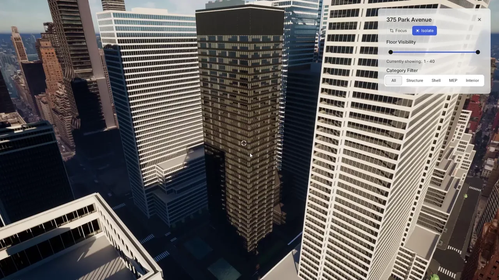
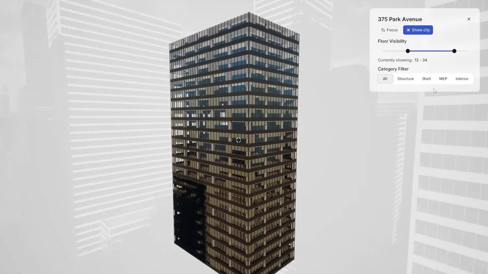
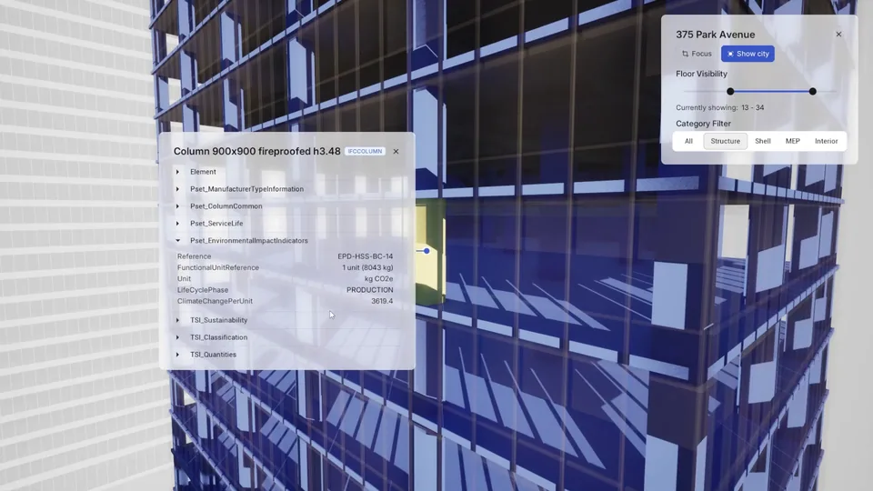
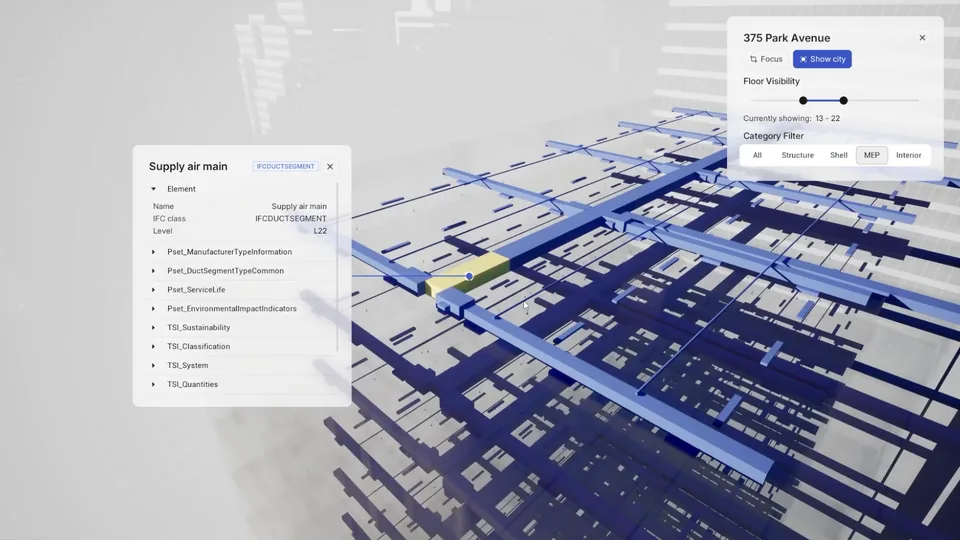

<h1 align="center">FragmentsUnreal</h1>

<p align="center"><b>Stream BIM models into Unreal Engine with every floor, category and property intact.</b><br>An Unreal Engine plugin that loads That Open <code>.frag</code> files (converted from IFC) as instanced meshes,<br>with level of detail built on import and the BIM data one Blueprint call away.</p>

<p align="center">
  <a href="#compatibility"></a>
  <a href="#compatibility"></a>
  <a href="LICENSE"></a>
  <a href="LICENSE"></a>
  <a href="#compatibility"></a>
  <a href="https://github.com/ThatOpen/engine_fragment"></a>
  <a href="https://github.com/fragever/FragmentsUnreal/releases/latest"></a>
</p>

<p align="center">
  <a href="https://www.fragmentsunreal.dev/"></a>
  &nbsp;
  <a href="https://github.com/fragever/FragmentsUnreal/releases/latest"></a>
  &nbsp;
  <a href="#install"></a>
  &nbsp;
  <a href="https://www.fragmentsunreal.dev/viewer/"></a>
</p>

<p align="center">
  <a href="#quick-start">Quick start</a> ·
  <a href="#gallery">Gallery</a> ·
  <a href="#what-it-does">What it does</a> ·
  <a href="#install">Install</a> ·
  <a href="#getting-a-frag-file">Getting a .frag</a> ·
  <a href="#compatibility">Compatibility</a> ·
  <a href="#limits">Limits</a> ·
  <a href="#contributing">Contributing</a>
</p>

<p align="center">
  
</p>

<p align="center"><sub>375 Park Avenue (40 floors, structure, MEP and interiors) with its city block, all loaded as <code>.frag</code> files. The panel is a demo app's own UI. The floor range, categories and element data behind it come from the plugin's Blueprint nodes.</sub></p>

---

Convert an IFC model to a `.frag` file, drop it into your level, and FragmentsUnreal builds it in the background while the game keeps running. Repeated elements like windows and columns become instanced meshes. Far away, a building is one simple shell. Up close, every element is there, and you can click it to read its IFC properties.

Everything works from Blueprint, in the editor and in a packaged game. No Nanite required.

## Quick start

1. Download the zip for your engine version from the [latest release](https://github.com/fragever/FragmentsUnreal/releases/latest).
2. Unzip it into `[YourProject]/Plugins/`, so the path is `Plugins/FragmentsUnreal/FragmentsUnreal.uplugin`.
3. Open the project and enable **FragmentsUnreal** in Edit → Plugins.
4. Open **Window → Fragments Viewer**, pick a `.frag` file and click **Load Fragment**.

That's it. The prebuilt zips work in Blueprint-only projects, with no C++ to build. Don't have a `.frag` yet? Open your `.ifc` in the [FragmentsUnreal Viewer](https://www.fragmentsunreal.dev/viewer/) and download one.

## Gallery

<table>
  <tr>
    <td width="33%"></td>
    <td width="33%"></td>
    <td width="33%"></td>
  </tr>
  <tr>
    <td><sub><b>Floor range</b>: <code>SetFloorVisibilityRange</code> cuts the tower to floors 13 to 34.</sub></td>
    <td><sub><b>Property sets</b>: click any element (<code>SelectAtScreenPos</code>) and read its IFC data with <code>GetElementDetail</code>.</sub></td>
    <td><sub><b>Categories</b>: <code>SetCategoryFilter</code> keeps the MEP and dims the rest.</sub></td>
  </tr>
</table>

## What it does

| | What you get | How you use it |
|---|---|---|
| **Streaming** | Whole buildings load in the background. File reading and mesh building run on worker threads, and the rest is paced against the frame budget. | `LoadFragmentAsync` in Blueprint, or the Fragments Viewer panel |
| **Level of detail** | Each model moves on its own between a simple shell (LOD2), merged cells (LOD1) and individual elements (LOD0), by how much of the screen it covers. No clicks or setup. | Automatic. `r.Fragments.LODDebug.Mode` shows the tiers |
| **Instancing** | Repeated elements (windows, columns, fixtures) become instanced meshes. One shadow caster per model, and a memory budget for merged cells. | Automatic. `r.Fragments.Memory.CellBudgetMB` |
| **BIM data** | Categories, attributes, property sets, element info and model metadata. | `GetElementDetail`, `GetItemPropertySets`, `GetCategoriesForModel` |
| **Filters and selection** | Floor ranges, category filters, ghosting and x-ray. Select an element at any distance: the model steps up its LOD until it finds what's under the cursor. | `SetFloorVisibilityRange`, `SetCategoryFilter`, `SelectAtScreenPos` |
| **Editor panel** | Batch import with cancel, a model list that follows the level, material overrides with drag and drop, live placement fields, undo and redo. | Window → Fragments Viewer |

## Install

| | How | Needs |
|---|---|---|
| **Prebuilt** (recommended) | Download the zip for your engine from the [latest release](https://github.com/fragever/FragmentsUnreal/releases/latest) and unzip it into `[YourProject]/Plugins/`. `SHA256SUMS.txt` has each zip's checksum. | UE 5.4 to 5.8, Win64. Any project, Blueprint-only included |
| **From source** | Clone or download this repository into `[YourProject]/Plugins/FragmentsUnreal/`, right-click your `.uproject`, choose **Generate Visual Studio project files**, and build **Development Editor / Win64**. | A C++ project and Visual Studio with the **Game development with C++** workload |

Pick the zip that matches your engine version: a build for one version won't load in another. The [getting started guide](https://www.fragmentsunreal.dev/docs/getting-started) walks through both paths with screenshots, plus loading models at runtime from Blueprint.

## Getting a .frag file

FragmentsUnreal reads `.frag`, not `.ifc`. To convert an IFC model:

- **[FragmentsUnreal Viewer](https://www.fragmentsunreal.dev/viewer/)**: open your `.ifc` in the browser, check it, and download the `.frag`. The file is processed in your browser and never uploaded.
- **[ifc2frag](https://github.com/fragever/ifc2frag)**: the viewer's source, if you want to run it locally (`npm install`, then `npm run dev`).
- Or use That Open's Fragments tooling directly: see [docs.thatopen.com](https://docs.thatopen.com/).

## Documentation

The [documentation site](https://www.fragmentsunreal.dev/docs/) covers installation, loading models in the editor and at runtime, the load sequence, materials, rendering with Movie Render Queue, Blueprint examples, the architecture and the full API reference.

## Compatibility

- **Unreal Engine**: 5.4 and later. Prebuilt zips for 5.4, 5.5, 5.6, 5.7 and 5.8.
- **Platforms**: Windows (Win64). libtess2 libraries for Android ARM64 are included.
- **Engine plugins**: ProceduralMeshComponent and GeometryScripting (the plugin enables them).
- **Third-party**: FlatBuffers and libtess2, both bundled. Nothing else to install.

## Limits

- **IFC needs converting first.** The plugin reads `.frag` only. The [Viewer](https://www.fragmentsunreal.dev/viewer/) converts in a few clicks.
- **Movie Render Queue can start before models finish loading.** Raise the Engine Warm Up Count for now. See [#1](https://github.com/fragever/FragmentsUnreal/issues/1) and the [MRQ guide](https://www.fragmentsunreal.dev/docs/rendering-with-mrq).
- **Packaged builds need two folders added to the cook** for material overrides and the plugin's own materials. See [#3](https://github.com/fragever/FragmentsUnreal/issues/3).
- **Very large cities can hitch while their far shells finish building.** See [#5](https://github.com/fragever/FragmentsUnreal/issues/5).

<details>
<summary><b>Repository structure</b></summary>

```
FragmentsUnreal/
├── Source/
│   ├── FragmentsUnreal/          # Runtime module
│   │   ├── Fragment/             # AFragment actor: per-element data, floors, visibility
│   │   ├── Importer/             # Import pipeline and Blueprint subsystem
│   │   ├── Spatial/              # Cells, proxies, LOD tiers and screen-space error
│   │   ├── Selection/            # Screen-position selection and traces
│   │   ├── Index/                # FlatBuffers Fragments schema
│   │   ├── Debug/                # LOD debug view
│   │   └── Utils/                # Frame budget, classification, helpers
│   └── FragmentsEditor/          # Editor module: Fragments Viewer panel, overrides
├── ThirdParty/
│   ├── FlatBuffers/              # FlatBuffers headers
│   └── libtess2/                 # Polygon triangulation (Win64 and Android ARM64 libs)
├── Content/
│   ├── Materials/                # Base, glass, outline and debug materials, MPC_Fragments
│   └── Resources/                # Panel fonts and icons
└── FragmentsUnreal.uplugin       # Plugin descriptor
```

</details>

## Contributing

Bug reports, ideas and pull requests are welcome.

- **Issues**: open an [issue](https://github.com/fragever/FragmentsUnreal/issues) with your Unreal Engine version, platform and steps to reproduce.
- **Pull requests**: work on a branch and open the PR against `main`. One task per PR, since we squash merge. Follow the Unreal Engine C++ coding standard and sign off your commits (`git commit -s`, see [CONTRIBUTING.md](CONTRIBUTING.md)).

If you build something with FragmentsUnreal, we'd love to see it.

## License

Original FragmentsUnreal code and documentation are licensed under the [Apache License 2.0](LICENSE): free to use in commercial projects. Third-party components keep their own licenses; see [NOTICE](NOTICE) and the files under `ThirdParty/`.

Maintained by **Jairo Andres Basto Picott** and **Arkoun Merchant**.
